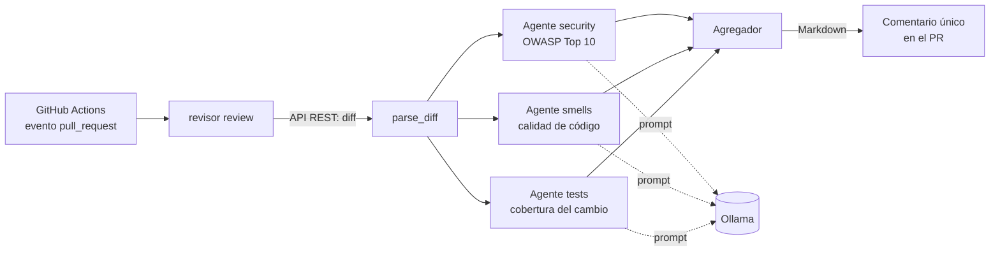

# Arquitectura

## Visión general

El revisor recibe el diff de un pull request, lo reparte entre tres agentes especializados que
trabajan en paralelo y un agregador que unifica sus resultados en un único comentario.

## Módulos (`src/revisor/`)

| Módulo | Responsabilidad |
|---|---|
| `diff.py` | Parsea el diff unificado: ficheros, hunks y números de línea nuevos. Numera las líneas añadidas (`L<n>:`) para que el modelo pueda citarlas. Clasifica ficheros de código y de test. |
| `models.py` | Esquemas Pydantic: `LLMFinding`/`LLMFindings` (salida estructurada del modelo) y `Finding` (con el agente que lo generó). |
| `agents.py` | Prompts y fábrica de agentes. Valida la salida del modelo (`sanitize`) y añade el aviso determinista de «código sin tests». |
| `graph.py` | Grafo LangGraph: los tres agentes salen de `START` en paralelo y convergen en `aggregate`. |
| `report.py` | Deduplica, ordena por gravedad y genera el Markdown con una marca oculta para actualizar el comentario. |
| `github.py` | Cliente mínimo de la API: leer el diff y crear/actualizar el comentario. |
| `cli.py` | Línea de comandos y construcción del modelo (`ChatOllama` con salida estructurada). |

## Decisiones de diseño

**Tres agentes con un solo criterio cada uno.** Un prompt que pide a la vez seguridad, calidad y
tests dispersa al modelo. Con agentes separados cada prompt es corto y se puede probar y mejorar
por separado. Cada prompt indica explícitamente qué *no* debe revisar, para evitar solapes.

**Ejecución en paralelo.** Los tres agentes no dependen entre sí, así que se lanzan desde `START`
y el agregador espera a los tres (`add_edge([...], "aggregate")`).

**Salida estructurada.** El modelo devuelve un objeto validado por Pydantic, no texto libre. Si el
formato es inválido, falla la llamada en vez de publicar basura.

**El modelo no es de fiar.** Todo lo que devuelve se filtra antes de publicarse:
- se descartan los hallazgos sobre ficheros que no están en el diff;
- la línea solo se conserva si es una línea realmente añadida;
- las rutas se normalizan (`a/`, `b/`, `./`) antes de compararlas con las del diff, y los descartes
  se registran en el log;
- se deduplica por `(fichero, línea)`: gana la gravedad más alta y, a igualdad, el agente de
  seguridad;
- todo texto del modelo se escapa antes de publicarse (menciones, enlaces, HTML, marca oculta).

**El diff es un dato no confiable.** Lo escribe el autor del PR. Va delimitado entre `<diff>` y
`</diff>`, el prompt indica que no debe obedecerse y el contenido no puede cerrar el delimitador.
Ver [amenazas.md](amenazas.md).

**Un agente caído no tumba la revisión.** Cada agente reintenta una vez; si sigue fallando se
conservan sus hallazgos estáticos y el informe indica qué falló, sin afirmar nunca que «no hay
problemas».

**Lo determinista, sin modelo.** El aviso «código modificado sin tests» se calcula con reglas
(`is_source_file` / `is_test_file`): es exacto, gratuito y no alucina.

**Un único comentario.** El informe lleva la marca `<!-- revisor-agents -->`. En cada ejecución se
busca ese comentario y se actualiza, en lugar de añadir uno nuevo por push.

**Modelo intercambiable.** Los agentes dependen del protocolo `StructuredLLM` (solo `invoke`). Los
tests usan un modelo falso, por lo que no necesitan Ollama ni red.

## Límites conocidos

- El diff se recorta a 12 000 caracteres por agente (`MAX_DIFF_CHARS`). Entran primero los ficheros
  que caben enteros y el resto se recorta; el informe lista los ficheros no revisados o recortados.
- Cada agente ve solo el diff, no el repositorio completo: no puede detectar un problema que
  dependa de código que el PR no toca.
- Un modelo de 7B produce falsos positivos y se le escapan casos. Los informes son una ayuda para
  quien revisa, no un veredicto.
- Los comentarios son del PR, no en línea sobre las líneas afectadas.
